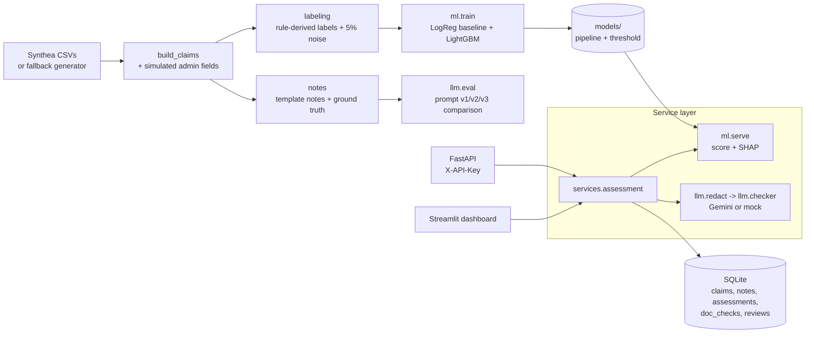

# ClaimGuard

A pre-submission **claim denial risk and documentation checker** for healthcare claims, built
entirely on **synthetic data**. It is a learning and portfolio project.

For each claim and its clinical note, ClaimGuard:

1. **Predicts denial risk** with a LightGBM model and explains the top five reasons with SHAP,
   in plain language (for example "No prior authorization on file (required for this procedure)").
2. **Checks documentation** with an LLM (Gemini): it reads the note, marks each required item as
   present, missing or unclear with a verbatim quote as evidence, and drafts a request for what is
   missing.
3. **Keeps a human in the loop**: a reviewer accepts, dismisses or escalates each flag in a
   Streamlit dashboard.

> **ClaimGuard never approves or denies a claim.** It only flags risk and suggests missing
> documentation. Decisions are made by humans. All data is synthetic; no real patient data is
> used. This is not a replica of any company's product and is not deployed, production-ready or
> HIPAA compliant.

## Why

Claims are often denied for administrative reasons: missing prior authorization, missing
documentation, code pairings that do not match, or late filing. Catching these before submission
is cheaper than appealing afterwards. Tabular claim fields suit a gradient-boosted model; free-text
notes suit an LLM. ClaimGuard combines both and leaves the decision to a person.

## Architecture



The API and the dashboard both call the same service layer; the dashboard has no HTTP hop.

## Data source used

**Synthea** (open-source synthetic patient generator), `master-branch-latest` jar (build
`d9d07a6`), run with 3,000 patients and seed 42. Synthea provides realistic structure (patients,
encounters, procedures, conditions, payers, providers). There is no public dataset of real claim
denials, so administrative fields (prior authorization, attached documents, submission delay,
coding errors) are **simulated** with a fixed seed and denial labels are **derived from documented
rules**, with 5% random label noise. See [docs/DATA_CARD.md](docs/DATA_CARD.md). If Java or the
download is unavailable, `scripts/download_data.py` falls back to a seeded pure-Python generator
that writes the same tables.

## Quickstart

Python 3.11+ and (optionally) Java 11+ for Synthea. Commands below are for Windows; on macOS or
Linux use `.venv/bin/` instead of `.venv\Scripts\`.

```bash
python -m venv .venv
.venv\Scripts\python -m pip install -r requirements.txt
.venv\Scripts\python -m pip install -e .
copy .env.example .env
```

Data, training and demo data in one go (about 2 minutes plus the Synthea download):

```bash
.venv\Scripts\python scripts/run_all.py
```

Or step by step:

```bash
.venv\Scripts\python scripts/download_data.py
.venv\Scripts\python -m claimguard.data.build_claims
.venv\Scripts\python -m claimguard.ml.train
.venv\Scripts\python scripts/load_demo_data.py
```

The LLM prompt evaluation is a **separate command** (needs a Gemini key):

```bash
.venv\Scripts\python -m claimguard.llm.eval
```

Run the API (demo only, not for public deployment) and open http://127.0.0.1:8000/docs:

```bash
.venv\Scripts\uvicorn claimguard.api.main:app --port 8000
```

Run the dashboard:

```bash
.venv\Scripts\streamlit run src/claimguard/dashboard/app.py
```

Run the quality gate:

```bash
.venv\Scripts\ruff check .
.venv\Scripts\ruff format --check .
.venv\Scripts\pytest --cov=claimguard
```

## How to add your Gemini key

1. Open `.env` (created from `.env.example`).
2. Replace `PASTE_YOUR_GEMINI_KEY_HERE` with your key: `GEMINI_API_KEY=...`. Never commit `.env`.
3. Optional: set `LLM_MODEL` (default `gemini-2.5-flash-lite`), `LLM_MAX_RPM` (default 10) and
   `LLM_MAX_CALLS_PER_RUN` (default 600).
4. Run the prompt evaluation: `.venv\Scripts\python -m claimguard.llm.eval`. It first checks the
   key with one tiny call; if the model name is rejected it lists models and picks a Flash-Lite or
   Flash model. Responses are cached in `.llm_cache/`, so an interrupted run resumes.
5. Refresh the demo assessments so some include the documentation check:
   `.venv\Scripts\python scripts/load_demo_data.py`.

Without a key everything still runs: the LLM step reports `llm_status = "not_configured"` and the
dashboard shows "LLM not configured" next to the ML result.

## API

All routes except `/health` need the header `X-API-Key` (value from `API_KEY` in `.env`, default
`dev-key-change-me`). This is demo protection only.

| Method | Path | Description |
|---|---|---|
| GET | `/health` | Liveness |
| POST | `/claims` | Create a claim with a note (note is redacted before storage) |
| GET | `/claims` | List with filters (`payer`, `status`) and pagination (`limit` up to 200, `offset`) |
| GET | `/claims/{id}` | Detail with the latest assessment |
| POST | `/claims/{id}/assess` | Run the assessment (ML + documentation check if configured) |
| POST | `/assessments/{id}/review` | `accept_flag`, `dismiss` or `escalate`, with a comment |
| GET | `/summary` | Aggregates |

## Results

All numbers are copied from `reports/` and come from **synthetic data with rule-derived labels**.
Because the labels are produced by rules, high scores show that the pipeline works, not that it
would work on real claims.

Denial model, time-based test set (6,005 claims, service dates 2024-11-22 to 2026-10-15, 19.62%
positive), from `reports/metrics.json`:

| Model | PR-AUC | ROC-AUC | F1 | Precision | Recall | Brier |
|---|---|---|---|---|---|---|
| LightGBM (served) | 0.8157 | 0.8913 | 0.8351 | 0.9221 | 0.7632 | 0.0546 |
| Logistic regression baseline | 0.7928 | 0.8776 | 0.7843 | 0.8625 | 0.7190 | 0.0683 |
| Majority class | 0.1962 | 0.5 | 0.0 | n/a | n/a | 0.1577 |

LightGBM threshold 0.6355 (maximises F1 on the validation slice). Predicted denial reason (on
denied test claims): accuracy 0.8192, macro F1 0.7972.

LLM documentation check (prompt v1/v2/v3 comparison): **TBD (not yet measured)**. It needs a
Gemini key; see above. Results will be written to `reports/prompt_eval.md` with the model name.

## Limitations

Simulated labels and notes, simple regex redaction, no real payer rules, small scale. See
[docs/LIMITATIONS.md](docs/LIMITATIONS.md). More detail: [model card](docs/MODEL_CARD.md),
[how it works](docs/HOW_IT_WORKS.md), [decisions](docs/DECISIONS.md).
